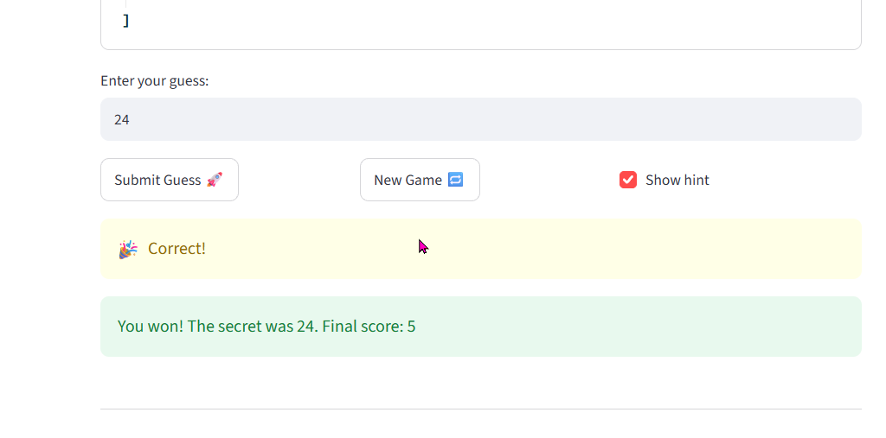

# 🎮 Game Glitch Investigator: The Impossible Guesser

## 🚨 The Situation

You asked an AI to build a simple "Number Guessing Game" using Streamlit.
It wrote the code, ran away, and now the game is unplayable. 

- You can't win.
- The hints lie to you.
- The secret number seems to have commitment issues.

## 🛠️ Setup

1. Install dependencies: `pip install -r requirements.txt`
2. Run the broken app: `python -m streamlit run app.py`

## 🕵️‍♂️ Your Mission

1. **Play the game.** Open the "Developer Debug Info" tab in the app to see the secret number. Try to win.
2. **Find the State Bug.** Why does the secret number change every time you click "Submit"? Ask ChatGPT: *"How do I keep a variable from resetting in Streamlit when I click a button?"*
3. **Fix the Logic.** The hints ("Higher/Lower") are wrong. Fix them.
4. **Refactor & Test.** - Move the logic into `logic_utils.py`.
   - Run `pytest` in your terminal.
   - Keep fixing until all tests pass!

## 📝 Document Your Experience

- In this project, I used Claude Code to investigate and fix bugs in a Python guessing game. I found that the High/Low hints were reversed and that the game sometimes compared numbers as strings instead of integers.

- I used Claude to understand the problems and suggest solutions. Before accepting the changes, I reviewed the Git diffs to make sure the fixes were correct. I also moved the game logic from app.py to logic_utils.py to separate the game logic from the user interface.

- Finally, I used pytest to verify the fixes. All eight tests passed. I learned that AI-generated code should always be reviewed and tested instead of being trusted without verification.

## 📸 Demo Walkthrough

Describe your fixed game in numbered steps so a reader can follow along without watching a video:
The game selected a secret number of 24.
1. I guessed 50, and the game told me to go lower.
2. I guessed 25, and the game told me to go lower.
3. I guessed 13, 19, and 22, and the game told me to go higher.
4. I guessed 24, and the game displayed "Correct!"
5. The game ended with a final score of 5.


**Screenshot** *(optional)*: <!-- Insert a screenshot of your fixed, winning game here -->

## 🧪 Test Results

```
# Paste your pytest output here, e.g.:
# pytest tests/
# ========================= X passed in 0.XXs =========================
```

## 🚀 Stretch Features

- [ ] [If you choose to complete Challenge 4, describe the Enhanced UI changes here — a screenshot is optional]
